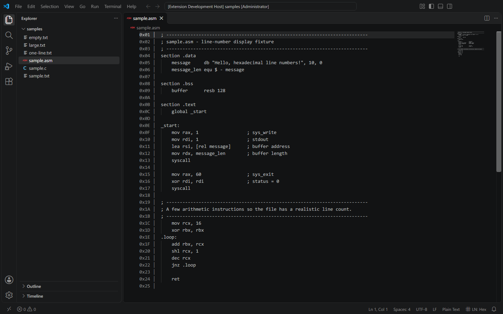
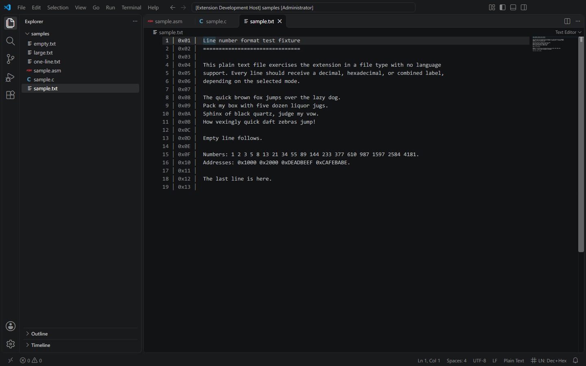
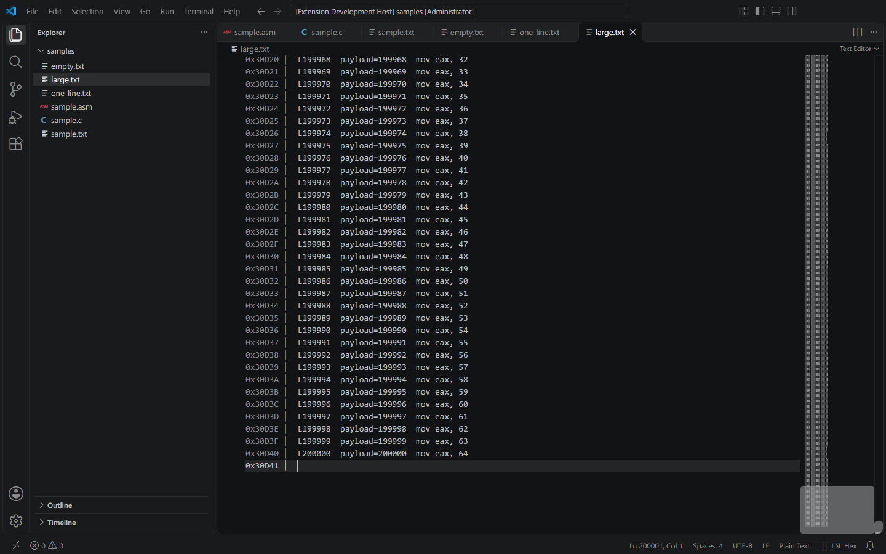

# Line Number Format — Decimal / Hexadecimal

Display VS Code line numbers as **decimal**, **hexadecimal**, or **both** — without patching VS Code. Built for disassembly listings, embedded/firmware work, and any text file where line numbers are really addresses.

[English](README.md) · [简体中文](README.zh-CN.md)

[](https://code.visualstudio.com/)
[](LICENSE)
[](https://github.com/ilubimu/microsoft-vscode-extension-line-number-format/releases/latest)



## Modes

| Mode | Appearance |
| --- | --- |
| Decimal | `1`, `2`, `3` — VS Code's native line-number gutter |
| Hexadecimal | `0x0001`, `0x0002`, `0x0003` |
| Decimal + Hexadecimal | `1 │ 0x0001` |

The mode is global, persisted in `lineNumberFormat.mode`, and applies to every text editor, independent of the file's language.

## Features

- **Three display modes**, switchable from the status bar or Command Palette.
- **No keybindings required.** Click the status-bar item (`LN: Dec` / `LN: Hex` / `LN: Dec+Hex`) or use the contributed commands.
- **Language-agnostic:** works in `.txt`, `.asm`, `.c`, `.py`, `.json`, `.md`, and any other text editor.
- **Separators** between decimal/hex and between the label column and the code, so labels never blur into the text.
- **Current-line highlighting** for the custom label column.
- **Large-file aware:** only visible ranges plus a 60-line forward / 15-line backward cushion are decorated; updates are capped to one per frame.
- **Screen Reader Optimized fallback:** the native decimal gutter stays visible in that mode, so the line-number column is never blank.
- **No runtime dependencies.** The extension is plain JavaScript and does not bundle Node modules.

## Install

This extension is distributed through **GitHub Releases** (not the Marketplace).

1. Open the [latest release](https://github.com/ilubimu/microsoft-vscode-extension-line-number-format/releases/latest).
2. Download `line-number-format-0.4.4.vsix`.
3. In VS Code, open **Extensions** → `...` → **Install from VSIX...** and select the file.
4. Or install from a terminal:

   ```bash
   code --install-extension line-number-format-0.4.4.vsix
   ```

Requirements: **VS Code 1.80 or newer** (tested with 1.147 on Windows). Reload the window if VS Code asks.

## Usage

## Usage

- Click the status-bar item to open the mode picker.
- Or run one of these commands from the Command Palette (`Ctrl+Shift+P`):

  - `Line Number Format: Choose Display Mode`
  - `Line Number Format: Use Decimal Line Numbers`
  - `Line Number Format: Use Hexadecimal Line Numbers`
  - `Line Number Format: Use Decimal + Hexadecimal Line Numbers`
  - `Line Number Format: Show Diagnostics`

There are intentionally **no keyboard shortcuts**.

## Settings

| Setting | Default | Description |
| --- | --- | --- |
| `lineNumberFormat.mode` | `decimal` | `decimal`, `hex`, or `both` |
| `lineNumberFormat.hexPrefix` | `true` | Prefix hexadecimal values with `0x` |
| `lineNumberFormat.hexUppercase` | `true` | Use uppercase `A–F` |
| `lineNumberFormat.hexPad` | `true` | Zero-pad hex values to the document's maximum line width |
| `lineNumberFormat.showSeparators` | `true` | Draw `│` between decimal/hex and before the code |
| `lineNumberFormat.activeLineHighlight` | `true` | Color the current line's label with the active line-number color |
| `lineNumberFormat.gap` | `2` | Empty character cells between the label column and the code (0–8) |

## Screenshots

| Decimal + Hexadecimal | Large file |
| --- | --- |
|  |  |

## How it works

VS Code's public extension API **cannot replace the text in the native line-number gutter**. The extension therefore:

- uses VS Code's native gutters in `Decimal` mode;
- in `Hex` / `Both` modes, turns the native gutter off and draws labels as inline `before` decorations at the start of each line.

This has a few intentional trade-offs:

- Inline labels move with horizontal scrolling; the native gutter does not.
- With word wrap enabled, wrapped continuation lines do not repeat the label.
- Labels are rendered content: selecting a line covers the label area, but labels are **not copied** and are not part of the document or search results.
- A monospace editor font (the VS Code default) gives the best alignment; label widths use `ch` units.
- Other extensions that directly change `editor.lineNumbers` may conflict.

## Screen Reader Optimized

When `editor.accessibilitySupport` is `"on"` (VS Code shows **Screen Reader Optimized**), Monaco updates visible lines and inline decorations through its accessibility path, which can lag on very large files. In that mode the extension keeps the native, accessible decimal gutter visible and overlays the hexadecimal labels. It avoids the blank line-number column, at the cost of showing both native decimal and custom hexadecimal labels.

If you do **not** use a screen reader, set:

```json
"editor.accessibilitySupport": "auto"
```

and reload to get a pure hexadecimal-only column.

## Performance

The renderer only decorates visible lines plus a small cushion, reuses decoration option objects, and throttles visible-range and selection updates to one per frame (16 ms). Cursor movement updates the active label on the next frame.

On a 200,000-line / 7.1 MB text file, measured in an isolated VS Code instance:

- 0 visible lines without a label during continuous scrolling;
- current-line label update ≈ 42–64 ms (including the CDP round trip);
- `Ctrl+End` label update ≈ 70–100 ms end-to-end;
- one render ≈ 0.5 ms for ~53 labels;
- 80 rapid hex/both switches plus far jumps: p95 command latency ≈ 4 ms, maximum extension-host event-loop lag ≈ 20 ms, labels settle in a few milliseconds.

Exact numbers vary with hardware, fonts, other extensions, and file size.

## Development

The repository includes black-box tests that launch a **separate copy** of VS Code with isolated user-data, extensions, and shared-data directories. Your installed VS Code and profile are not touched.

### Repository layout

```text
src/                 Extension source (plain JavaScript)
images/icon.png      Extension icon
docs/                README screenshots
test/unit/           Pure formatting tests
test/visual/         CDP-driven UI tests, stress test, and VSIX install test
test/stress-helper/  Tiny helper extension used only by the stress test
test/fixtures/       Sample .asm/.c/.txt files
test/setup-runtime.ps1  Copies the installed VS Code into _test-runtime
tools/build-vsix.js  Dependency-free VSIX packager
tools/make-icon.ps1  Regenerates images/icon.png
```

### Run tests on Windows

The tests use the Electron runtime bundled with VS Code, so a global Node.js installation is not required.

```bat
powershell -ExecutionPolicy Bypass -File test\setup-runtime.ps1

set ELECTRON_RUN_AS_NODE=1
..\_test-runtime\vscode\Code.exe test\unit\run.js
..\_test-runtime\vscode\Code.exe test\visual\run-visual-test.js
..\_test-runtime\vscode\Code.exe test\visual\run-stress-test.js
..\_test-runtime\vscode\Code.exe tools\build-vsix.js
..\_test-runtime\vscode\Code.exe test\visual\run-vsix-test.js
```

The visual test generates its own 200,000-line fixture under `_test-runtime` and writes screenshots to `test-output/` (both gitignored). The stress test switches hexadecimal/both 80 times while jumping around the same large file, then drags the real scrollbar immediately after switching modes. Set `LNF_STRESS_CYCLES`, `LNF_STRESS_INTERVAL_MS`, and `LNF_STRESS_A11Y=off` to vary the load; set `LNF_STRESS_A11Y=off` to test the pure hex column instead of the screen-reader fallback. `test/setup-runtime.ps1` accepts `-VsCodePath` if VS Code is installed elsewhere.

### Package

`tools/build-vsix.js` writes `dist/line-number-format-0.4.4.vsix`. No npm dependencies or `vsce` are needed.

## Changelog

See [CHANGELOG.md](CHANGELOG.md). **0.4.3 is the first public release; 0.4.4 fixes rapid mode-switch and scroll responsiveness.**

## License

[MIT](LICENSE)
