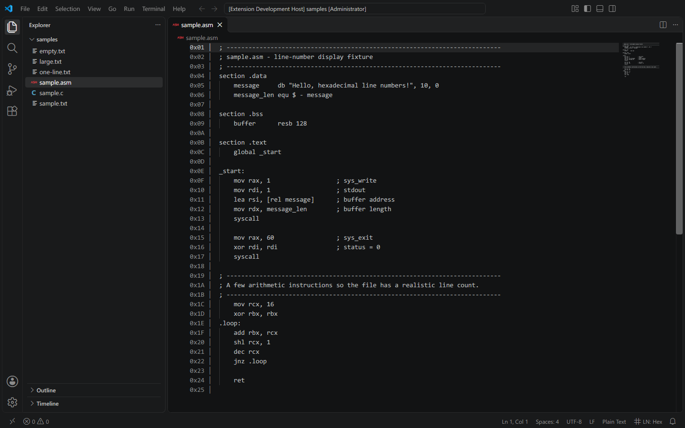
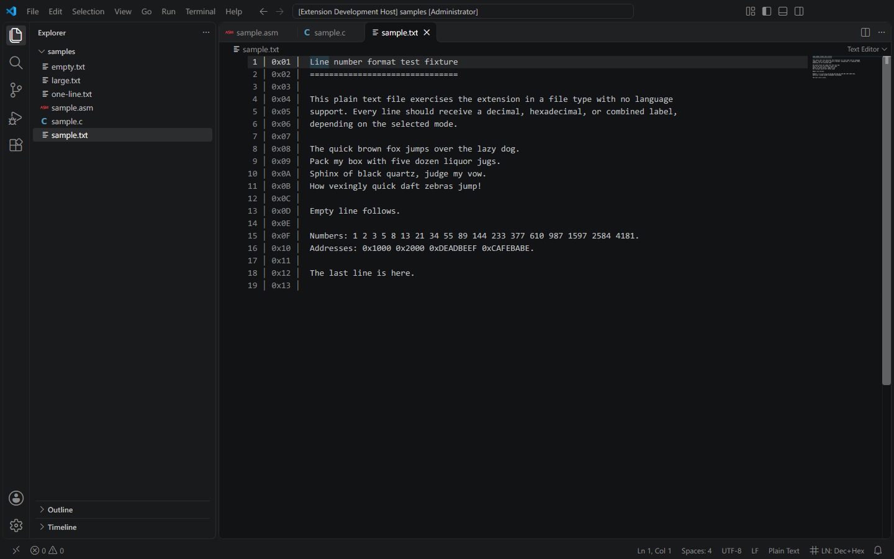
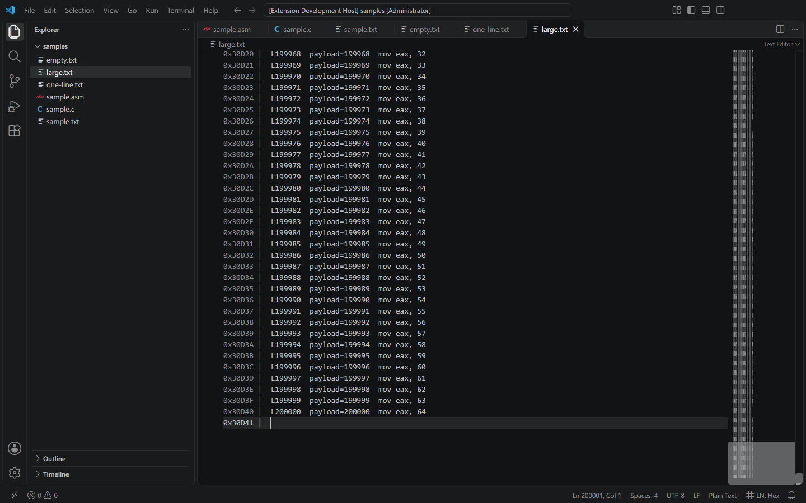

# Line Number Format — 十进制 / 十六进制行号

把 VS Code 的行号显示为**十进制**、**十六进制**，或**两者同时显示**，无需修改 VS Code 本体。适用于反汇编列表、嵌入式/固件开发，以及任何“行号其实代表地址”的文本文件。

[English](README.md) · [简体中文](README.zh-CN.md)



## 三种模式

| 模式 | 显示效果 |
| --- | --- |
| 十进制 | `1`、`2`、`3`（VS Code 原生行号） |
| 十六进制 | `0x0001`、`0x0002`、`0x0003` |
| 十进制 + 十六进制 | `1 │ 0x0001` |

模式是全局设置，保存在 `lineNumberFormat.mode`，对所有文本编辑器和文件类型生效，与语言扩展无关。

## 功能

- 三种显示模式，可从状态栏或命令面板切换。
- **不需要快捷键**：点击状态栏的 `LN: Dec` / `LN: Hex` / `LN: Dec+Hex`，或使用贡献的命令。
- 支持 `.txt`、`.asm`、`.c`、`.py`、`.json`、`.md` 等所有文本文件。
- 十进制/十六进制之间、标签与正文之间有 `│` 分隔符，避免数字与代码粘连。
- 当前行的行号标签使用 active 颜色高亮。
- 大文件友好：只装饰可见区域及前后少量缓冲，滚动更新最多每帧一次。
- **Screen Reader Optimized 回退**：该模式下保留原生、可访问的十进制行号，行号列不会空白。
- 无运行时依赖：扩展是纯 JavaScript，不打包 node_modules。

## 安装

扩展通过 **GitHub Releases** 分发（暂未发布到 Marketplace）。

1. 打开 [Latest Release](https://github.com/ilubimu/microsoft-vscode-extension-line-number-format/releases/latest)。
2. 下载 `line-number-format-0.4.4.vsix`。
3. VS Code → 扩展视图 → 右上角 `...` → **Install from VSIX...**，选择该文件。
4. 或命令行：

   ```bash
   code --install-extension line-number-format-0.4.4.vsix
   ```

要求：**VS Code 1.80 或更高**（在 Windows 的 1.147 上测试）。如提示重载窗口，重载即可。

## 使用

## 使用

- 点击状态栏的 `LN:` 项打开模式选择。
- 或在命令面板（`Ctrl+Shift+P`）中运行：

  - `Line Number Format: Choose Display Mode`
  - `Line Number Format: Use Decimal Line Numbers`
  - `Line Number Format: Use Hexadecimal Line Numbers`
  - `Line Number Format: Use Decimal + Hexadecimal Line Numbers`
  - `Line Number Format: Show Diagnostics`

没有注册任何快捷键。

## 设置

| 设置 | 默认值 | 说明 |
| --- | --- | --- |
| `lineNumberFormat.mode` | `decimal` | `decimal` / `hex` / `both` |
| `lineNumberFormat.hexPrefix` | `true` | 十六进制是否带 `0x` |
| `lineNumberFormat.hexUppercase` | `true` | 是否使用大写 `A–F` |
| `lineNumberFormat.hexPad` | `true` | 按文档最大行号零填充 |
| `lineNumberFormat.showSeparators` | `true` | 是否显示 `│` 分隔符 |
| `lineNumberFormat.activeLineHighlight` | `true` | 当前行是否使用 active 行号颜色 |
| `lineNumberFormat.gap` | `2` | 标签列与代码之间的空格字符数（0–8） |

## 截图

| 双显模式 | 大文件 |
| --- | --- |
|  |  |

## 实现方式与限制

VS Code 的扩展 API **不能替换原生 gutter 中的行号文本**，因此：

- `decimal` 模式使用原生行号；
- `hex` / `both` 模式关闭原生行号，在每行行首用 inline `before` decoration 绘制标签。

取舍：

- 标签会随水平滚动移动；原生 gutter 不会。
- 开启自动换行时，续行不会重复标签。
- 标签是渲染内容：选区高亮会覆盖标签，但标签不会被复制、不会进入文档或搜索结果。
- 建议使用等宽字体；标签宽度使用 `ch` 单位。
- 其他直接修改 `editor.lineNumbers` 的扩展可能冲突。

## Screen Reader Optimized

当 `editor.accessibilitySupport` 为 `"on"`（VS Code 状态栏显示 **Screen Reader Optimized**）时，Monaco 通过无障碍路径刷新可见行和行内装饰，超大文件上可能明显延迟。此时扩展会保留原生、可访问的十进制行号，并叠加十六进制标签，避免行号列空白；代价是同时看到原生十进制和自定义十六进制。

如果你**不使用读屏**，把设置改为：

```json
"editor.accessibilitySupport": "auto"
```

并重载，即可得到纯十六进制列。

## 性能

只装饰可见行及少量缓冲；行内选项、Map 和数组复用；滚动和选区更新每帧最多一次（16 ms），光标移动在下一帧更新当前行标签。

在 20 万行 / 7.1 MB 文本文件上的隔离测试：

- 连续滚动时 0 行可见代码缺标签；
- 当前行标签更新约 42–64 ms（含 CDP 往返）；
- `Ctrl+End` 端到端约 70–100 ms；
- 单次渲染约 0.5 ms / 53 个标签；
- 80 次快速十六进制/双显切换并穿插远距离跳转：命令延迟 p95 约 4 ms，扩展宿主事件循环最大卡顿约 20 ms，标签在数毫秒内追平。

实际数字会随硬件、字体、其他扩展和文件大小变化。

## 开发与测试

测试会启动**单独复制的 VS Code**，使用独立的 user-data、extensions 和 shared-data 目录，不会影响你已安装的 VS Code。

### 目录结构

```text
src/                 扩展源码（纯 JavaScript）
images/icon.png      扩展图标
docs/                README 截图
test/unit/           纯函数格式化测试
test/visual/         CDP 驱动的 UI 测试、压力测试和 VSIX 安装测试
test/stress-helper/  仅压力测试使用的辅助扩展
test/fixtures/       示例 .asm/.c/.txt
test/setup-runtime.ps1  把本机 VS Code 复制到 _test-runtime
tools/build-vsix.js  无依赖的 VSIX 打包脚本
tools/make-icon.ps1  重新生成 images/icon.png
```

### Windows 下运行测试

测试使用 VS Code 自带的 Electron 运行时，不需要全局安装 Node.js。

```bat
powershell -ExecutionPolicy Bypass -File test\setup-runtime.ps1

set ELECTRON_RUN_AS_NODE=1
..\_test-runtime\vscode\Code.exe test\unit\run.js
..\_test-runtime\vscode\Code.exe test\visual\run-visual-test.js
..\_test-runtime\vscode\Code.exe test\visual\run-stress-test.js
..\_test-runtime\vscode\Code.exe tools\build-vsix.js
..\_test-runtime\vscode\Code.exe test\visual\run-vsix-test.js
```

视觉测试会在 `_test-runtime` 下生成 20 万行样本，并把截图写入 `test-output/`（均已 gitignore）。压力测试会在同一个大文件上快速切换 80 次十六进制/双显并穿插远距离跳转，然后在切换后立即拖动真实滚动条。可用 `LNF_STRESS_CYCLES`、`LNF_STRESS_INTERVAL_MS` 调整负载；`LNF_STRESS_A11Y=off` 用于测试纯十六进制列（而不是读屏回退）。`test/setup-runtime.ps1` 支持 `-VsCodePath` 指定 VS Code 安装位置。

### 打包

`tools/build-vsix.js` 生成 `dist/line-number-format-0.4.4.vsix`，不依赖 npm 或 `vsce`。

## 更新日志

见 [CHANGELOG.md](CHANGELOG.md)。**0.4.3 是第一个公开发布版本；0.4.4 修复快速切换模式与滚动时的卡顿和刷新延迟。**

## License

[MIT](LICENSE)
